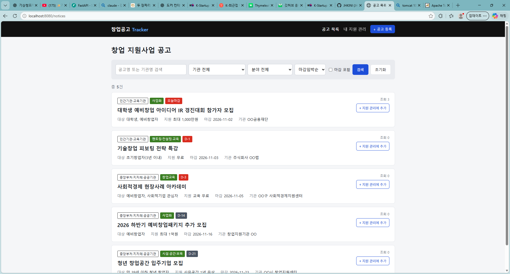
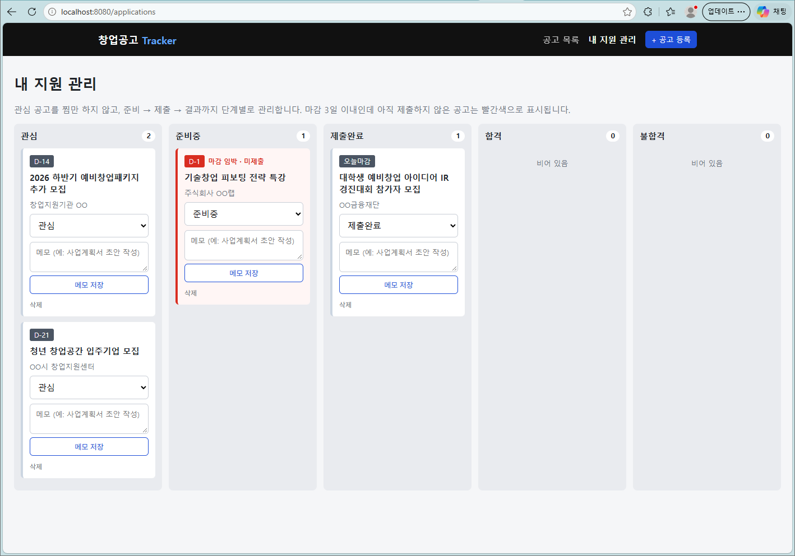

# 창업공고 Tracker

> 창업 지원사업 공고를 **찾는 데서 끝나지 않고**, 관심 → 준비중 → 제출완료 → 결과까지 **지원 과정을 관리**하는 Spring Boot 게시판




<br>

## 📌 프로젝트 소개

K-Startup 같은 창업 지원사업 공고 사이트를 쓰면서 느낀 불편함에서 시작한 프로젝트입니다.

| 기존 사이트의 불편함 | 이 프로젝트에서 바꾼 점 |
|---|---|
| 목록에 제목만 두 번 나오고 **지원 대상·지원 규모가 안 보임** | 카드에 **대상 / 지원 규모 / 마감일 / 기관**을 바로 표시 |
| 관심공고(♡)는 **찜만 되고 진행 상황을 관리할 수 없음** | **지원 관리 보드**: 관심 → 준비중 → 제출완료 → 합격/불합격 |
| 마감일순 정렬만 있음 | 마감 3일 이내인데 **아직 제출하지 않은 공고를 빨간색으로 경고** |
| 마감된 공고가 목록에 섞여 있음 | 기본으로 **진행중 공고만** 표시, "마감 포함" 체크로 함께 보기 |

<br>

## 🛠 기술 스택

| 구분 | 기술 |
|---|---|
| Language | Java 21 |
| Framework | Spring Boot 4.1, Spring MVC, Spring Data JPA, Bean Validation |
| View | Thymeleaf |
| DB | MySQL 8 |
| Build | Maven |
| 기타 | Lombok |

<br>

## ✨ 주요 기능

### 1. 공고 CRUD
- 공고 등록 / 목록 / 상세 / 수정 / 삭제
- 등록·수정 폼에서 **입력값 검증** (필수값, 길이, 접수 시작일 ≤ 마감일), 에러를 필드별로 표시
- **소프트 삭제**: 실제로 지우지 않고 `deleted` 플래그만 변경
- 상세 조회 시 조회수 증가

### 2. 검색 · 필터 · 정렬
- 공고명 / 기관명 키워드 검색
- 기관 구분(공공·민간), 지원 분야 필터
- 정렬: 마감임박순(기본) / 최신등록순 / 조회순
- 페이징 (1페이지부터 시작하는 응답 형식으로 변환)
- 마감일까지 남은 날짜를 `D-3`, `오늘마감`, `마감` 라벨로 표시

### 3. 지원 관리 보드 (핵심 차별점)
- 공고를 "지원 관리에 추가"하면 **관심** 상태로 시작
- 5단계 칸반 보드: **관심 / 준비중 / 제출완료 / 합격 / 불합격**
- 상태 변경 규칙을 `ApplyStatus.canChangeTo()`에 정의
  - 관심 · 준비중 · 제출완료끼리는 자유롭게 이동
  - 합격 · 불합격은 **제출완료 이후에만** 선택 가능
  - 화면의 드롭다운에도 **바꿀 수 있는 상태만** 표시
- 공고별 메모 작성 (예: "사업계획서 초안 작성")
- 마감 3일 이내 + 미제출 → 🔴 **마감 임박 경고**, 마감 지남 + 미제출 → 흐리게 표시
- 같은 공고 중복 추가 방지 (서비스 검증 + DB unique 제약), 마감된 공고는 추가 불가

<br>

## 🗂 ERD

```
notice                                application
─────────────────────────            ─────────────────────────
id (PK)                    1 ──── 0..1 id (PK)
title                                 notice_id (FK, UNIQUE)
organization                          status   (INTERESTED / PREPARING /
org_type   (PUBLIC/PRIVATE)                     SUBMITTED / PASSED / FAILED)
category                              memo
target, region, support_amount        created_at, updated_at
start_date, deadline
apply_url, content
view_count
status     (OPEN/CLOSED)
deleted
created_at, updated_at
```

<br>

## 📁 패키지 구조

```
com.myspring.noticeboard
├─ notice          공고 도메인 (Entity, Repository, Service, REST Controller)
│  └─ dto          NoticeRequest, NoticeListResponse, NoticeDetailResponse
├─ application     지원 관리 도메인 (상태 Enum, Entity, Repository, Service, REST Controller)
│  └─ dto
├─ web             Thymeleaf 화면 컨트롤러 + 폼 객체
└─ global          공통 응답(PageResponse), 예외 처리
```

- **화면(Thymeleaf)과 REST API를 분리**했습니다. 같은 Service를 `web` 컨트롤러(HTML)와 REST 컨트롤러(JSON)가 함께 사용합니다.
- 목록 응답과 상세 응답의 **DTO를 분리**해서, 목록에서는 필요한 정보만 내려줍니다.

<br>

## 🔗 REST API

### 공고 `/api/notices`
| Method | URL | 설명 |
|---|---|---|
| POST | `/api/notices` | 공고 등록 (201 + Location) |
| GET | `/api/notices?keyword=&orgType=&category=&includeClosed=&sort=&page=&size=` | 목록 (검색·필터·정렬·페이징) |
| GET | `/api/notices/{id}` | 상세 (조회수 +1) |
| PUT | `/api/notices/{id}` | 수정 |
| DELETE | `/api/notices/{id}` | 소프트 삭제 (204) |

### 지원 관리 `/api/applications`
| Method | URL | 설명 |
|---|---|---|
| POST | `/api/applications` | 지원 관리에 추가 `{"noticeId": 1}` |
| GET | `/api/applications?status=PREPARING` | 목록 (상태 필터) |
| PATCH | `/api/applications/{id}/status` | 상태 변경 `{"status": "SUBMITTED"}` |
| PATCH | `/api/applications/{id}/memo` | 메모 수정 |
| DELETE | `/api/applications/{id}` | 삭제 |

### 에러 응답 형식
```json
{
  "status": 400,
  "message": "입력값을 확인해주세요.",
  "errors": { "title": "제목은 필수입니다." }
}
```
| 상황 | 상태 코드 |
|---|---|
| 입력값 검증 실패, 잘못된 파라미터 | 400 |
| 없는 공고 / 지원 내역 | 404 |
| 이미 추가된 공고, 허용되지 않는 상태 변경 | 409 |

<br>

## 💡 구현하면서 신경 쓴 점

- **N+1 문제 방지**: 지원 관리 보드를 불러올 때 `join fetch`로 공고까지 쿼리 한 번에 조회
- **엔티티에 setter를 두지 않음**: `update()`, `changeStatus()`, `delete()` 같은 의미 있는 메서드로만 상태 변경
- **비즈니스 규칙을 도메인에 둠**: 상태 변경 가능 여부는 `ApplyStatus`, 마감 여부 계산은 `Notice`가 담당
- **트랜잭션**: Service 기본값은 `readOnly = true`, 쓰기 메서드에만 `@Transactional` 적용
- **예외 처리 분리**: REST 컨트롤러는 `@RestControllerAdvice`로 JSON 에러를 응답하고, 화면에서는 Flash 메시지로 안내
- **Open Redirect 방지**: 화면 이동용 `returnUrl`은 내부 경로(`/`로 시작)만 허용

<br>

## ▶ 실행 방법

1. MySQL 8 실행 (DB는 첫 실행 때 `noticeboard_db`로 자동 생성)
2. DB 계정 정보를 환경변수로 설정 (비밀번호는 코드에 직접 적지 않습니다)

   | 환경변수 | 설명 | 기본값 |
   |---|---|---|
   | `DB_PASSWORD` | DB 비밀번호 | 없음 (필수) |
   | `DB_USERNAME` | DB 계정 | `root` |
   | `DB_URL` | JDBC URL | `jdbc:mysql://localhost:3306/noticeboard_db?...` |

   ```bash
   # macOS / Linux / Git Bash
   export DB_PASSWORD=본인비밀번호
   ```
   ```powershell
   # Windows PowerShell
   $env:DB_PASSWORD="본인비밀번호"
   ```
   > IntelliJ에서 실행할 경우 Run Configuration → Environment variables에 `DB_PASSWORD=본인비밀번호` 추가
3. 실행
   ```bash
   ./mvnw spring-boot:run
   ```
4. 브라우저에서 http://localhost:8080 접속
   - 첫 실행 때 샘플 공고 6개가 자동으로 등록됩니다.

<br>

## 🚀 앞으로 추가할 기능

- [ ] 로그인 / 회원별 지원 관리 (Spring Security)
- [ ] `@Scheduled`로 마감일이 지난 공고를 자동으로 CLOSED 처리
- [ ] 조회수 중복 증가 방지
- [ ] 내 조건(대학생·예비창업자·지역) 기반 "지원 가능한 공고" 필터
- [ ] 공공데이터포털 창업 지원사업 공고 API 연동
- [ ] Service / Controller 테스트 코드
